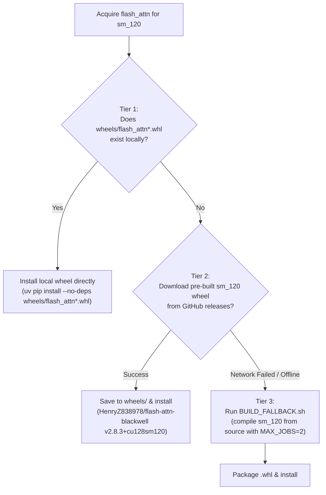

# InSpace Standalone Inference Engine (`standalone_inspace`)

Production-ready 3D indoor scene generation pipeline engineered for a streamlined two-tier hardware lifecycle:
- **Local Dev / Testing (`sm_75` / Turing / T4):** Run locally via `uv sync` / Python with dynamic runtime architecture detection and memory-efficient `xformers` attention routing.
- **Production Deployment (`sm_120` / Blackwell / RTX 50-series):** Deploy via **Docker** engineered strictly for Blackwell hardware, utilizing high-throughput native `flash_attn` v2 (72 embedded `sm_120` cubins) and `flex_gemm` sparse convolution.

---

## Key Features

1. **Dual Execution Modes:**
   - **Headless CLI (`--mode cli`):** Granular stage-by-stage command-line interface for automated, scripted, and cloud cluster workflows.
   - **Interactive Web UI (`--mode gradio`):** Full-featured Gradio 6.0.1 demo on port 7860.
2. **Targeted Multi-Tier Hardware Architecture:**
   - **Local Testing Mode (`uv sync`):** Dynamic compute capability probe at runtime (automatically routes `sm_75` to `xformers`).
   - **Production Docker Container:** Lean image dedicated strictly to Blackwell `sm_120` (zero `xformers` bloat in container), hardwiring `ATTN_BACKEND=flash_attn`.
   - **`flex_gemm`:** High-performance sparse conv engine replacing `spconv`.
3. **Dense Point Cloud Support (200,000+ Points):**
   - Ingests raw LiDAR, Matterport, or photogrammetry point clouds directly.
   - Discrete $64^3$ quantization with `np.unique` deduplication: **zero extra GPU VRAM cost** regardless of input point count.
   - Removed the arbitrary 50k point cap (`--stg1-max-points None` default) and added fast Statistical Outlier Removal (`--stg1-clean-sor`).
4. **Intelligent Output Resolution:**
   - Precedence: Explicit `--output` $\to$ `INSPACE_OUTPUT` env $\to$ `/data/outputs` (Docker) $\to$ `./output` (local script).
5. **Complete 3D Asset Export:**
   - Generates PBR-textured `.glb`, Wavefront `.obj` + `.mtl`, Stanford `.ply`, oriented 3D bounding boxes (`.json` + `.npy`), coarse occupancy grids, and multi-view camera verification renders.

---

## 3-Tier `flash_attn` Acquisition Strategy

To guarantee Blackwell (`sm_120`) execution in any deployment environment:



---

## Quickstart

### 1. Run with Docker Compose (Recommended)

#### Headless Batch CLI Execution:
```bash
docker-compose run --rm inspace-cli \
  --input /data/living_room.jpg \
  --output /data/outputs \
  --stg1-steps 25 \
  --stg3-steps 50 \
  --stg4-steps 50
```

#### Interactive Web UI:
```bash
docker-compose up inspace-gradio
# Open http://localhost:7860 in your browser
```

### 2. Standalone Docker Run
```bash
# Build image
docker build -t inspace-inference:latest .

# Run CLI inference
docker run --gpus all --rm \
  -v $(pwd)/checkpoints:/checkpoints \
  -v $(pwd)/data:/data \
  -v $(pwd)/outputs:/data/outputs \
  inspace-inference:latest \
  --input /data/panorama.jpg \
  --output /data/outputs
```

### 3. Local Python Script
```bash
python app.py \
  --input ./data/room.jpg \
  --output ./output \
  --stg1-steps 25 \
  --stg2-threshold 0.3 \
  --stg3-steps 50 \
  --stg4-steps 50
```

---

## Full CLI Reference

```
python app.py [GLOBAL OPTIONS] [STAGE 1 OPTIONS] [STAGE 2 OPTIONS] [STAGE 3 OPTIONS] [STAGE 4 OPTIONS]
```

### 1. Global Options
| Flag | Type | Default | Description |
|---|---|---|---|
| `-i, --input` | PATH | `None` | Input ERP panorama (`.jpg`/`.png`/`.exr`), cubemap folder, or sample directory. |
| `-o, --output` | PATH | `./output` or `/data/outputs` | Destination directory for generated meshes, bboxes, voxels, and renders. |
| `--mode` | `cli` \| `gradio` | Auto | Run mode (defaults to `cli` if `--input` provided, otherwise `gradio`). |
| `--checkpoint-dir` | PATH | `/checkpoints` | Directory storing model weights (auto-downloads from HF if missing). |
| `--hf-key` | TEXT | `None` / `$HF_TOKEN` | Hugging Face API token for downloading gated models (`facebook/dinov3`). |
| `--gpu-id` | TEXT | `"0"` | GPU index for `CUDA_VISIBLE_DEVICES`. |
| `--device` | TEXT | `"cuda"` | Torch computation device. |
| `--seed` | INT | `42` | Global random seed for reproducible sampling. |
| `--low-vram / --no-low-vram` | BOOL | `True` | Sequentially offload inactive stage models from GPU VRAM. |
| `--save-glb / --no-save-glb` | BOOL | `True` | Export PBR textured `.glb` models for overall scene, layout, and assets. |
| `--save-obj / --no-save-obj` | BOOL | `True` | Export Wavefront `.obj` and `.mtl` mesh files. |
| `--save-ply / --no-save-ply` | BOOL | `True` | Export Stanford `.ply` point clouds and meshes. |
| `--save-renders / --no-renders` | BOOL | `True` | Render exterior, interior, and top-down camera views to PNG. |
| `--save-voxels / --no-voxels` | BOOL | `True` | Save $64^3$ binary occupancy grid (`.npy`) and SS latents (`.npz`). |
| `--port` | INT | `7860` | Gradio web UI server port. |
| `--share` | FLAG | `False` | Create a public Gradio share link. |

### 2. Stage 1: Coarse Scene Geometry (`--stg1-****`)
| Flag | Type | Default | Description |
|---|---|---|---|
| `--stg1-enable / --no-stg1` | BOOL | `True` | Enable/disable Stage 1 SS Flow generation. |
| `--stg1-steps` | INT | `25` | Denoising diffusion steps for SS Flow (range: 5–100). |
| `--stg1-cfg` | FLOAT | `7.5` | Classifier-Free Guidance scale for coarse geometry. |
| `--stg1-seed` | INT | `None` | Stage 1 specific random seed override. |
| `--stg1-use-sdedit / --no-stg1-sdedit` | BOOL | `False` | Use SDEdit noise initialization from depth/point cloud prior. |
| `--stg1-alpha` | FLOAT | `0.5` | SDEdit noise interpolation ratio ($0.0 \to 1.0$). |
| `--stg1-depth-input` | PATH | `None` | Optional depth map (`.png`/`.exr`/`.npy`) for SDEdit prior. |
| `--stg1-pointcloud-input` | PATH | `None` | Optional dense point cloud (`.ply`/`.xyz`/`.npy`) for geometric prior. |
| `--stg1-max-points` | INT | `None` | Subsampling cap (`None` = unlimited 200,000+ points). |
| `--stg1-clean-sor / --no-stg1-clean-sor` | BOOL | `True` | Statistical Outlier Removal (cKDTree) to prevent wall dilation. |
| `--stg1-voxel-input` | PATH | `None` | Skip Stage 1 and load pre-computed occupancy voxels directly. |
| `--stg1-config` | PATH | `None` | Stage 1 model config JSON override. |
| `--stg1-ckpt` | PATH | `None` | Stage 1 checkpoint directory override. |

### 3. Stage 2: 3D Bounding Box Estimation (`--stg2-****`)
| Flag | Type | Default | Description |
|---|---|---|---|
| `--stg2-enable / --no-stg2` | BOOL | `True` | Enable/disable Stage 2 CenterPoint 3D bounding box estimation. |
| `--stg2-source` | `predicted` \| `gt` \| `custom` | `predicted` | Bounding box source. |
| `--stg2-threshold` | FLOAT | `0.3` | CenterPoint detection confidence threshold (range: 0.05–0.95). |
| `--stg2-iou-nms` | FLOAT | `0.3` | 3D IoU Non-Maximum Suppression threshold. |
| `--stg2-nms-kernel` | INT | `7` | NMS window kernel size. |
| `--stg2-max-assets` | INT | `30` | Maximum cap on detected bounding boxes to process. |
| `--stg2-custom-bbox` | PATH | `None` | Path to pre-computed bounding boxes (`.json` or `.npz`). |
| `--stg2-config` | PATH | `None` | Stage 2 model config JSON override. |
| `--stg2-ckpt` | PATH | `None` | Stage 2 checkpoint directory override. |

### 4. Stage 3: Asset-Aware Shape SLat Generation (`--stg3-****`)
| Flag | Type | Default | Description |
|---|---|---|---|
| `--stg3-enable / --no-stg3` | BOOL | `True` | Enable/disable Stage 3 Shape SLat generation. |
| `--stg3-steps` | INT | `50` | Flow sampling steps for Shape SLat (range: 10–100). |
| `--stg3-cfg` | FLOAT | `3.0` | Classifier-Free Guidance scale for shape. |
| `--stg3-seed` | INT | `None` | Stage 3 specific random seed override. |
| `--stg3-layout-mode` | `floor_perimeter` \| `overall` \| `none` | `floor_perimeter` | Architectural layout boundary extraction algorithm. |
| `--stg3-pipeline-type` | `1024_cascade` \| `512` \| `1024` \| `1536_cascade` | `1024_cascade` | Resolution cascade configuration. |
| `--stg3-max-tokens` | INT | `32768` | Maximum token cap for sparse cascade attention. |
| `--stg3-config` | PATH | `None` | Stage 3 model config JSON override. |
| `--stg3-ckpt` | PATH | `None` | Stage 3 checkpoint directory override. |

### 5. Stage 4: Asset-Aware Texture SLat & PBR Baking (`--stg4-****`)
| Flag | Type | Default | Description |
|---|---|---|---|
| `--stg4-enable / --no-stg4` | BOOL | `True` | Enable/disable Stage 4 Texture SLat & PBR baking (False = shape-only). |
| `--stg4-steps` | INT | `50` | Flow sampling steps for Texture SLat (range: 10–100). |
| `--stg4-cfg` | FLOAT | `3.0` | Classifier-Free Guidance scale for texture. |
| `--stg4-seed` | INT | `None` | Stage 4 specific random seed override. |
| `--stg4-resolution` | INT | `512` | Texture atlas baking resolution: 512, 1024, 2048. |
| `--stg4-fill-holes / --no-fill` | BOOL | `True` | Mesh manifold hole-filling before PBR projection. |
| `--stg4-decimate-target` | INT | `None` | Polygon reduction target face count per mesh. |
| `--stg4-config` | PATH | `None` | Stage 4 model config JSON override. |
| `--stg4-ckpt` | PATH | `None` | Stage 4 checkpoint directory override. |

---

## Dense Point Cloud (200k+ Points) Mechanics

When passing dense point cloud scans (e.g. 2 Lakhs / 200,000 points from LiDAR or depth sensors) directly into InSpace via `--stg1-pointcloud-input`:

1. **Quantization Filter into $64^3$ Voxels:**
   $$\text{voxel\_indices} = \text{clip}\left(\lfloor(\mathbf{p}_{\text{norm}} + 0.5) \times 64\rfloor, 0, 63\right)$$
   `np.unique` deduplicates continuous points into discrete occupied cells. Between 10 and 30 dense points collapse into each occupied cell.
2. **Zero Extra GPU VRAM Cost:**
   The neural network input tensor shape is strictly invariant:
   $$\text{Shape: } [1, 1, 64, 64, 64] \quad (\approx 1.05 \text{ MB})$$
   Passing 5,000 points or 500,000 points consumes the exact same GPU VRAM.
3. **Statistical Outlier Removal:**
   Sensor jitter is cleaned on CPU with fast cKDTree filtering before voxelization, preventing artificial wall dilation.

---

## Output Directory Layout

Every executed scene generates a structured artifact folder under `<output_dir>/<sample_name>/`:

```
<output_dir>/<sample_name>/
├── summary.json          # Complete execution parameters, timings, and detection statistics
├── meshes/
│   ├── scene.glb         # Complete PBR textured scene (roughness/metallic/base_color)
│   ├── scene.obj         # Wavefront OBJ mesh
│   ├── scene.mtl         # Material definition
│   ├── scene.ply         # Stanford PLY mesh
│   ├── layout.glb        # Isolated architectural envelope (floor + walls only)
│   ├── layout.obj
│   ├── layout.ply
│   └── assets/           # Individual decomposed 3D assets detected by CenterPoint
│       ├── 000_chair.glb / .obj / .ply
│       ├── 001_table.glb / .obj / .ply
│       └── ...
├── bboxes/
│   ├── bboxes_3d.json    # Oriented 3D bounding boxes [cx, cy, cz, sx, sy, sz, yaw]
│   └── bboxes_3d.npy
├── voxels/
│   ├── voxel_64.npy      # Stage 1 64^3 coarse occupancy grid
│   └── ss_latent.npz     # Stage 1 sparse structure latent [8, 16, 16, 16]
└── vis/                  # Multi-view camera verification renders
    ├── cubemap_input.png       # 2x3 grid of cubemap faces
    ├── bbox_topdown.png        # Top-down view with bounding box overlays
    ├── ss_exterior_ccm.png     # Coarse geometry exterior render (4 angles)
    ├── ss_topdown_cam_ccm.png
    ├── ss_interior_ccm.png     # Coarse geometry interior camera view
    ├── geometry_exterior.png   # Decoded shape mesh normal map render
    ├── geometry_topdown_cam.png
    ├── texture_exterior.png    # Final PBR textured exterior render
    └── texture_topdown_cam.png
```

---

## Pretrained Checkpoints

Checkpoints are loaded from `CHECKPOINT_DIR` (`/checkpoints` in Docker). If the directory is empty, InSpace automatically downloads all weights from Hugging Face (`GwanHyeong/InSpace`):

```bash
# Manual download option:
hf download GwanHyeong/InSpace --include "ckpts/*" --local-dir ./checkpoints
```

Base TRELLIS-2 weights (`microsoft/TRELLIS.2-4B` and `microsoft/TRELLIS-image-large`) are auto-cached via Hugging Face Hub during the first execution.

